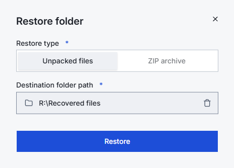
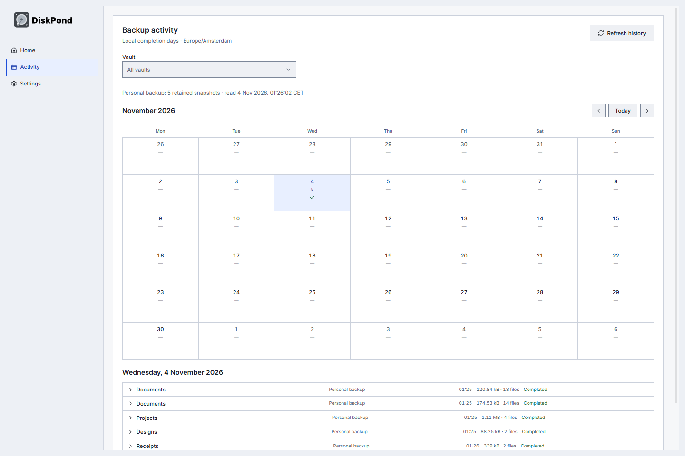
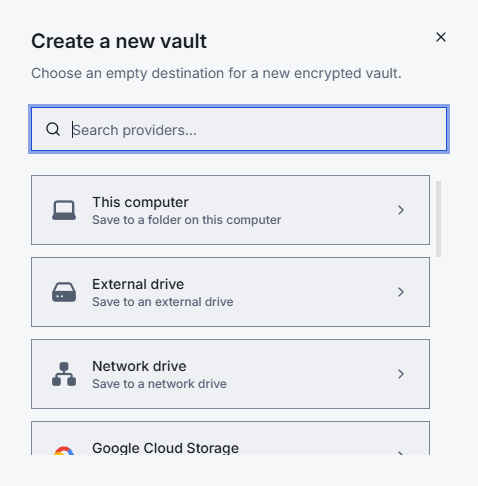
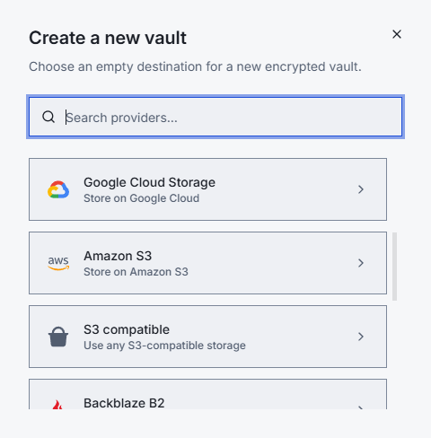
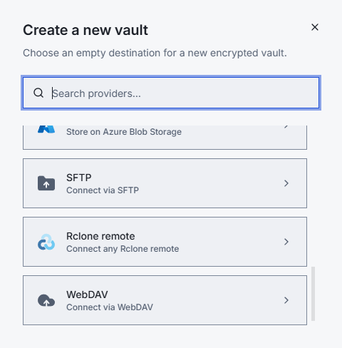

# DiskPond

<picture>
  <source media="(prefers-color-scheme: dark)" srcset="libs/assets/brand/diskpond-logo-dark.svg">
  
</picture>

**Encrypted backups. Your storage. No account.**

DiskPond is a free, open-source desktop backup app for Windows. Back up files and folders, keep earlier versions, compare what changed, and restore the files you need—all using storage you control.

[**Download for Windows**](https://github.com/hoxsec/DiskPond/releases/latest/download/DiskPond-Windows.exe) · [Release notes](https://github.com/hoxsec/DiskPond/releases/latest) · [Installation & recovery](docs/windows-release.md)

Windows 10/11 · x64 · **v0.1.5**. The installer is currently unsigned; installation details and checksums are on the release page.

<picture>
  <source media="(prefers-color-scheme: dark)" srcset="docs/images/vault-dark.png">
  
</picture>

## Features

- **Encrypted, versioned backups** with incremental storage, deduplication and compression, powered by the Kopia-derived engine.
- **Your choice of storage** with multiple independent vaults and separate create/connect flows.
- **Available storage** on each filesystem vault's destination, refreshed automatically in its overview.
- **Manual or scheduled backups**, retention rules, pinned backups and file exclusions.
- **Browse and restore** individual files, selected items or whole folders; export a folder as a ZIP.
- **Compare backups** to see added, changed and deleted paths, with before/after sizes and modification times.
- **Activity calendar** for retained backups, with vault filtering and compact, expandable backup details.
- **Light, dark and system themes**, keyboard navigation and tray/background operation.
- **In-app updates** with download progress, cancellation, release notes, reminders and local update history. Restart and install once backups/restores are idle.
- **Account-free BYO backups**, with no required subscription, analytics or automatic crash uploads. Credentials use OS-protected storage, with session-only storage when protection is unavailable.

### Choose when and what to back up

Vault-wide defaults, per-folder policies, scheduled or manual backups, exclusions, and advanced compression and retention controls.

<picture>
  <source media="(prefers-color-scheme: dark)" srcset="docs/images/policies-dark.png">
  
</picture>

### Browse a version. Bring your files back.

Open a saved backup, browse its folders, and inspect file sizes and modification times. Restore a file, selected items, or a whole folder.

<picture>
  <source media="(prefers-color-scheme: dark)" srcset="docs/images/browser-dark.png">
  
</picture>

Choose unpacked files or a ZIP archive and a separate destination for recovery:

<picture>
  <source media="(prefers-color-scheme: dark)" srcset="docs/images/restore-dark.png">
  
</picture>

### See what changed

Compare two backups to inspect added, changed and deleted paths with before-and-after sizes and modification times.

<picture>
  <source media="(prefers-color-scheme: dark)" srcset="docs/images/comparison-dark.png">
  
</picture>

### Keep track of your backups

<picture>
  <source media="(prefers-color-scheme: dark)" srcset="docs/images/activity-dark.png">
  
</picture>

Screenshots use the actual Windows app, disposable demo files and five real snapshots across four folders. Images follow your light/dark theme. The calendar reflects retained history; it is not a complete log of every failed or canceled attempt.

## Storage integrations

**11 connection options** in the app’s searchable storage picker:

| Local & network | Object storage | Other connections |
| --- | --- | --- |
| <picture><source media="(prefers-color-scheme: dark)" srcset="docs/images/connections-local-dark.png"></picture> | <picture><source media="(prefers-color-scheme: dark)" srcset="docs/images/connections-cloud-dark.png"></picture> | <picture><source media="(prefers-color-scheme: dark)" srcset="docs/images/connections-remote-dark.png"></picture> |
| Internal and external drives | Amazon S3 and S3-compatible services | SFTP |
| Mounted network drives / NAS | Backblaze B2 | WebDAV |
| | Google Cloud Storage, Azure Blob | Rclone remotes |

NAS/network drives use an OS-mounted path or Windows share. Rclone uses remotes configured separately on your computer. These integrations are available in the app; provider-by-provider certification and macOS/Linux releases are tracked in the [roadmap](ROADMAP.md).

## Get started

1. [Install DiskPond](docs/windows-release.md) and choose **Create a new vault**, or **Connect an existing vault** to open existing backup storage.
2. Choose your destination and encryption password, then add files or folders.
3. Run a backup. Open its history to browse, compare or restore a saved version.

Scheduled backups run while DiskPond is open or running in the tray. Keep your vault password somewhere recoverable.

## Build from source

### Website

The [DiskPond website](apps/marketing/README.md) includes product pages, downloads, backup guides and upcoming managed-storage plans. Preview it locally with `pnpm dev:site`; build static hosting output with `pnpm build:site`. The website currently accepts email enquiries, with 500 GB announced at €5/month including VAT or €45/year. Cloud checkout and storage provisioning are pending.

Website pages, pricing copy and screenshots are separate from the desktop installer. `DiskPond-Windows.exe` contains the desktop app, backup engine, app assets and licenses; the website belongs in its own static deployment and the release's source archive.

### Desktop app

Use Node **24.15.0**, pnpm **11.7.0**, and Go **1.25.5**:

```powershell
git clone --recurse-submodules https://github.com/hoxsec/DiskPond.git
cd DiskPond
pnpm install --frozen-lockfile
pnpm dev:desktop
```

[Build instructions](DEVELOPMENT.md) · [Contributing](AGENTS.md) · [Report an issue](https://github.com/hoxsec/DiskPond/issues) · [Roadmap](ROADMAP.md)

## License and credits

DiskPond is a fork of [BlinkDisk](https://github.com/blinkdisk/blinkdisk), licensed under [**AGPL-3.0**](LICENSE). Its [Kopia-derived engine fork](https://github.com/hoxsec/diskpond-core) retains its separate [**Apache-2.0** license](apps/core/LICENSE). Thanks to the BlinkDisk, Kopia and dependency contributors.

[Upstream provenance and modification record](UPSTREAM.md). Third-party dependencies and assets retain their own licenses.
