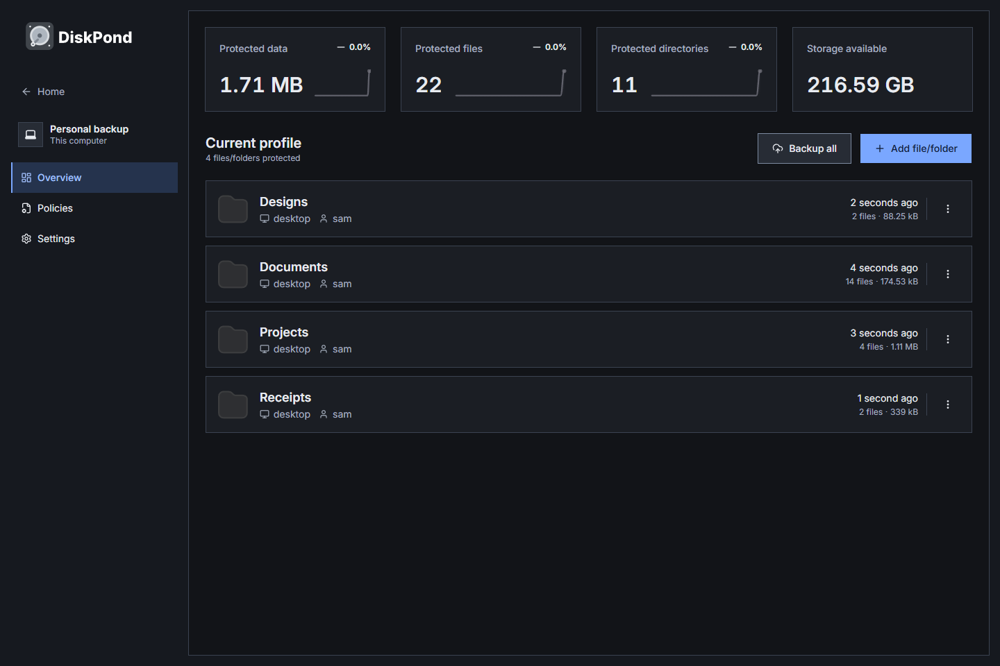
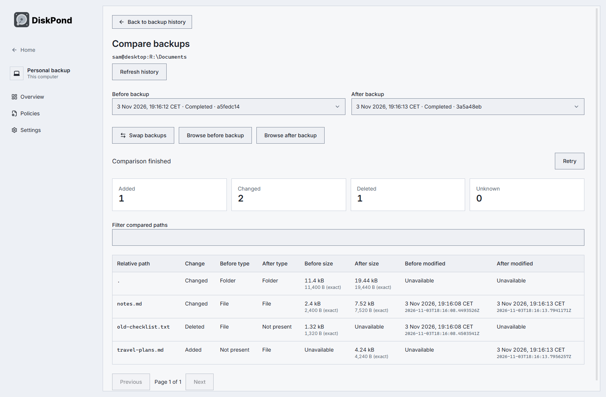
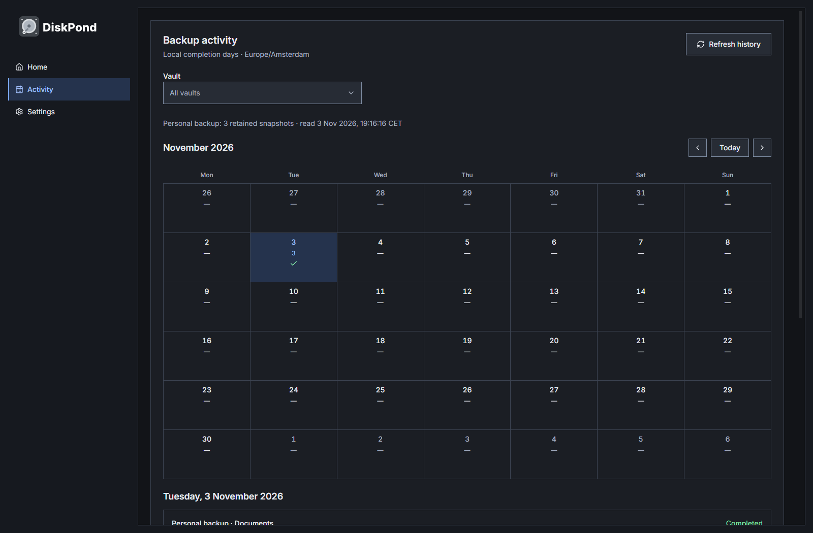

# DiskPond

<picture>
  <source media="(prefers-color-scheme: dark)" srcset="libs/assets/brand/diskpond-logo-dark.svg">
  
</picture>

**Encrypted backups. Your storage. No account.**

DiskPond is a free, open-source desktop backup app for Windows. Back up files and folders, keep earlier versions, compare what changed, and restore the files you need—all using storage you control.

[**Download for Windows**](https://github.com/hoxsec/DiskPond/releases/latest/download/DiskPond-Windows.exe) · [Release notes](https://github.com/hoxsec/DiskPond/releases/latest) · [Installation & recovery](docs/windows-release.md)

Windows 10/11 · x64 · **v0.1.1**. The installer is currently unsigned; installation details and checksums are on the release page.



## Features

- **Encrypted, versioned backups** with incremental storage, deduplication and compression, powered by the Kopia-derived engine.
- **Your choice of storage** with multiple independent vaults and separate create/connect flows.
- **Available storage** on each filesystem vault's destination, refreshed automatically in its overview.
- **Manual or scheduled backups**, retention rules, pinned backups and file exclusions.
- **Browse and restore** individual files, selected items or whole folders; export a folder as a ZIP.
- **Compare backups** to see added, changed and deleted paths, with before/after sizes and modification times.
- **Activity calendar** for retained backups, with vault filtering and compact, expandable backup details.
- **Light, dark and system themes**, keyboard navigation and tray/background operation.
- **Update notifications** with a manual check in Settings and a link to GitHub releases.
- **Account-free and private**: no subscriptions, analytics or automatic crash uploads. Credentials use OS-protected storage, with session-only storage when protection is unavailable.

### See what changed



### Keep track of your backups



Screenshots use disposable demo files and real backups. The calendar reflects retained history; it is not a complete log of every failed or canceled attempt.

## Storage integrations

| Local & network | Object storage | Other connections |
| --- | --- | --- |
| Internal and external drives | Amazon S3 and S3-compatible services | SFTP |
| Mounted network drives / NAS | Backblaze B2 | WebDAV |
| | Google Cloud Storage, Azure Blob | Rclone remotes |

These integrations are available in the app. Provider-by-provider certification and macOS/Linux releases are tracked in the [roadmap](ROADMAP.md).

## Get started

1. [Install DiskPond](docs/windows-release.md) and choose **Create a new vault**, or **Connect an existing vault** to open existing backup storage.
2. Choose your destination and encryption password, then add files or folders.
3. Run a backup. Open its history to browse, compare or restore a saved version.

Scheduled backups run while DiskPond is open or running in the tray. Keep your vault password somewhere recoverable.

## Build from source

Use Node **24.15.0**, pnpm **11.7.0**, and Go **1.25.5**:

```powershell
git clone --recurse-submodules https://github.com/hoxsec/DiskPond.git
cd DiskPond
pnpm install --frozen-lockfile
pnpm dev:desktop
```

[Build instructions](DEVELOPMENT.md) · [Contributing](AGENTS.md) · [Report an issue](https://github.com/hoxsec/DiskPond/issues) · [Roadmap](ROADMAP.md)

## License and credits

DiskPond is a fork of [BlinkDisk](https://github.com/blinkdisk/blinkdisk), licensed under [**AGPL-3.0**](LICENSE). Its [Kopia-derived engine fork](https://github.com/hoxsec/diskpond-core) retains its separate [**Apache-2.0** license](apps/core/LICENSE). Thanks to the BlinkDisk, Kopia and dependency contributors.

[Upstream provenance and modification record](UPSTREAM.md). Third-party dependencies and assets retain their own licenses.
