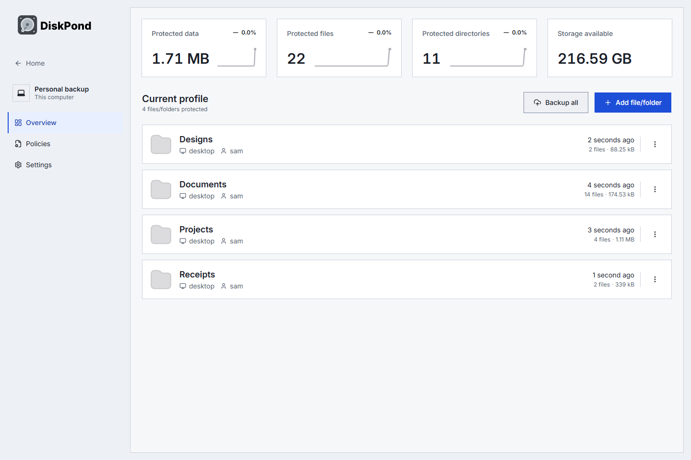
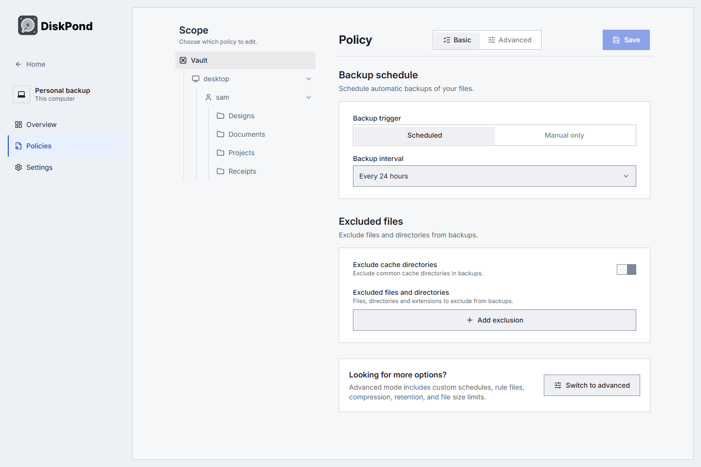
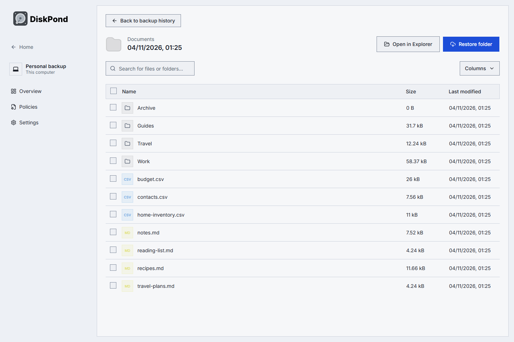

# DiskPond

<picture>
  <source media="(prefers-color-scheme: dark)" srcset="libs/assets/brand/diskpond-logo-dark.svg">
  
</picture>

**Encrypted backups. Your storage. No account.**

DiskPond is a free, open-source desktop backup app for **Windows, Linux and macOS**. Back up files and folders, keep earlier versions, compare what changed, and restore the files you need—all using storage you control.

[**Download the latest release**](https://github.com/hoxsec/DiskPond/releases/latest) · [**All releases**](https://github.com/hoxsec/DiskPond/releases) · [Installation guide](docs/desktop-release.txt) · [Report an issue](https://github.com/hoxsec/DiskPond/issues)

## Downloads

Current release: **[v0.1.9](https://github.com/hoxsec/DiskPond/releases/tag/v0.1.9)**.

| Platform | Download |
| --- | --- |
| Windows x64 | [Windows installer](https://github.com/hoxsec/DiskPond/releases/latest/download/DiskPond-Windows.exe) |
| macOS Intel and Apple Silicon | [Universal DMG](https://github.com/hoxsec/DiskPond/releases/latest/download/DiskPond-macOS.dmg) |
| Linux x64, ARM64 and ARMv7 | [AppImage, DEB and RPM packages](https://github.com/hoxsec/DiskPond/releases/latest) |

Installation instructions and checksums are available on the release page. Windows and Linux packages are unsigned; macOS packages are ad-hoc signed without Apple notarization.

## Features

- **Encrypted, versioned backups** with incremental storage, deduplication and compression, powered by the Kopia-derived engine.
- **Your choice of storage**, with multiple independent vaults and separate create/connect flows.
- **Home overview** with protected data, file and snapshot counts, estimated storage savings, and a backup setup meter.
- **Detailed vault cards** with destination information, latest-backup times, status, storage capacity where supported, and Open vault/Reconnect actions.
- **Manual or scheduled backups**, retention rules, pinned backups, file exclusions and per-folder policies.
- **Browse and restore** individual files, selected items or whole folders; export a folder as a ZIP.
- **Compare backups** to inspect added, changed and deleted paths, including sizes and modification times.
- **Activity calendar** with selectable vault summaries, backup history and expandable backup/issue details.
- **Eight desktop languages**: English, Spanish, French, German, Turkish, Dutch, Italian and Polish.
- **Light, dark and system themes**, keyboard navigation and tray/background operation.
- **Update support** with in-app downloads on Windows and Linux AppImage; macOS and Linux DEB/RPM installations link to the matching release for manual installation.
- **Account-free backups** to your own storage, with no required subscription, analytics or automatic crash uploads. Credentials use OS-protected storage, with session-only storage when protection is unavailable.

## A look inside

These screenshots show the Windows app with disposable demo files and real backups. They predate the v0.1.9 Home, vault-card and Activity redesign; images follow your light/dark theme.

<picture>
  <source media="(prefers-color-scheme: dark)" srcset="docs/images/vault-dark.png">
  
</picture>

### Choose when and what to back up

Set vault-wide defaults, per-folder policies, schedules, exclusions, compression and retention controls.

<picture>
  <source media="(prefers-color-scheme: dark)" srcset="docs/images/policies-dark.png">
  
</picture>

### Browse a version. Bring your files back.

Open a saved backup, browse its folders, and restore files to a separate destination as unpacked files or a ZIP archive.

<picture>
  <source media="(prefers-color-scheme: dark)" srcset="docs/images/browser-dark.png">
  
</picture>

### See what changed

Compare two backups to inspect added, changed and deleted paths.

<picture>
  <source media="(prefers-color-scheme: dark)" srcset="docs/images/comparison-dark.png">
  
</picture>

## Storage integrations

| Local & network | Object storage | Other connections |
| --- | --- | --- |
| Internal and external drives | Amazon S3 and S3-compatible services | SFTP |
| Mounted network drives / NAS | Backblaze B2 | WebDAV |
| | Google Cloud Storage, Azure Blob | Rclone remotes |

NAS/network drives use an OS-mounted path or Windows share. Rclone uses remotes configured separately on your computer. The app also includes a DiskPond Cloud connection flow; account and storage management live at [cloud.diskpond.com](https://cloud.diskpond.com).

## Get started

1. [Install DiskPond](docs/desktop-release.txt), then choose **Create a new vault** or **Connect an existing vault**.
2. Choose your destination and encryption password, then add files or folders.
3. Run a backup. Open its history to browse, compare or restore a saved version.

Scheduled backups run while DiskPond is open or running in the tray. Keep your vault password somewhere recoverable.

## Build from source

Use Node **24.15.0**, pnpm **11.7.0**, and Go **1.25.5**:

```sh
git clone --recurse-submodules https://github.com/hoxsec/DiskPond.git
cd DiskPond
pnpm install --frozen-lockfile
pnpm dev:desktop
```

Build native packages on their matching operating system with `pnpm build:windows`, `pnpm build:linux`, or `pnpm build:macos`.

This repository contains the desktop interface (`apps/desktop`), Electron runtime (`apps/electron`), backup engine (`apps/core`) and shared libraries (`libs`). The website, customer portal and managed-storage service are maintained separately in [hoxsec/diskpond-vault](https://github.com/hoxsec/diskpond-vault).

[Development guide](DEVELOPMENT.txt) · [Release and installation guide](docs/desktop-release.txt) · [Windows recovery walkthrough](docs/windows-release.txt) · [Website](https://diskpond.com)

## License and credits

DiskPond is a fork of [BlinkDisk](https://github.com/blinkdisk/blinkdisk), licensed under [**AGPL-3.0**](LICENSE). Its [Kopia-derived engine fork](https://github.com/hoxsec/diskpond-core) retains its separate [**Apache-2.0** license](apps/core/LICENSE). Thanks to the BlinkDisk, Kopia and dependency contributors.

[Upstream provenance and modification record](UPSTREAM.txt). Third-party dependencies and assets retain their own licenses.
